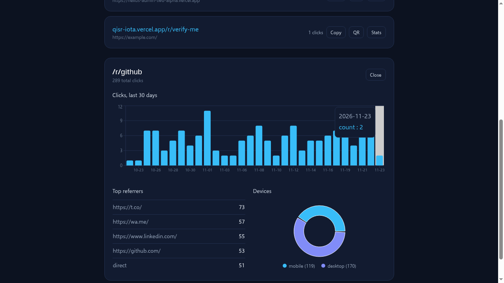

# Qisr - URL Shortener & Click Analytics

A full-stack URL shortener with click analytics: an Express REST API with validation, rate limiting and QR code generation, plus a React dashboard to create links, copy them, view QR codes and inspect click statistics.

> **Live demo:** https://qisr-iota.vercel.app
>
> **Demo data:** the live demo runs in in-memory mode with three seeded demo links (`github`, `portfolio`, `nexus-demo`). Data resets on redeploy/restart. All sample links and click counts shown there are demo data.



## Features

- **Shorten URLs** with a generated slug or a custom alias (validated, collision-checked)
- **Redirect endpoint** under `/r/:slug` with click tracking (timestamp, referrer, device type)
- **Click analytics** per link: total clicks, recent click log, device breakdown, charts (bar + pie)
- **QR codes** generated on demand as data URLs
- **Hardened API**: helmet headers, CORS allowlist, rate limiting, zod request validation, own-host loop refusal
- **Dashboard UI**: create links, copy to clipboard, expand per-link QR + stats
- **9 integration tests** (node:test) covering health, create/validate flows, redirects, tracking and stats

## Tech stack

| Layer    | Tech |
|----------|------|
| Frontend | React 19, Vite, Tailwind CSS, Recharts, Axios |
| Backend  | Node.js, Express, helmet, express-rate-limit, zod, qrcode |
| Storage  | JSON file store locally, in-memory store on Vercel (demo mode) |
| Tests    | node:test + supertest-style requests against the app |
| Deploy   | Vercel (serverless API + static client) |

## API

| Method | Endpoint | Description |
|--------|----------|-------------|
| GET    | `/api/health` | Service status + demo-mode flag |
| POST   | `/api/links` | Create a short link (`{ url, slug? }`) |
| GET    | `/api/links` | List links, sorted by clicks |
| GET    | `/api/links/:slug/stats` | Click stats for one link |
| GET    | `/api/links/:slug/qr` | QR code as PNG data URL |
| GET    | `/r/:slug` | 302 redirect to the target URL (tracks the click) |

Validation errors return `400` with a zod-derived message; duplicate slugs return `409`.

## Run locally

```bash
npm install
npm run dev        # server on :4000, client on :5173 (proxied)
npm test           # 9 integration tests
npm run build      # production client build
```

## Project layout

```
qisr/
  api/index.js        # Vercel serverless entry (wraps the Express app)
  server/             # Express API (routes, store, config) + tests
  client/             # React + Vite + Tailwind dashboard
  vercel.json         # build + rewrites (/api and /r -> serverless fn)
```

## Notes

- Clicks are recorded on redirect: timestamp, referrer header and a coarse device classification (mobile/desktop) from the user agent.
- The seeded demo links make the dashboard explorable immediately in demo mode.
